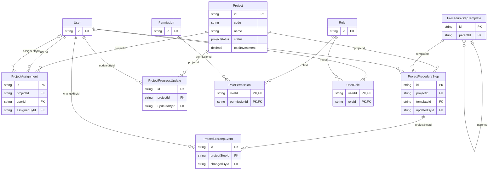
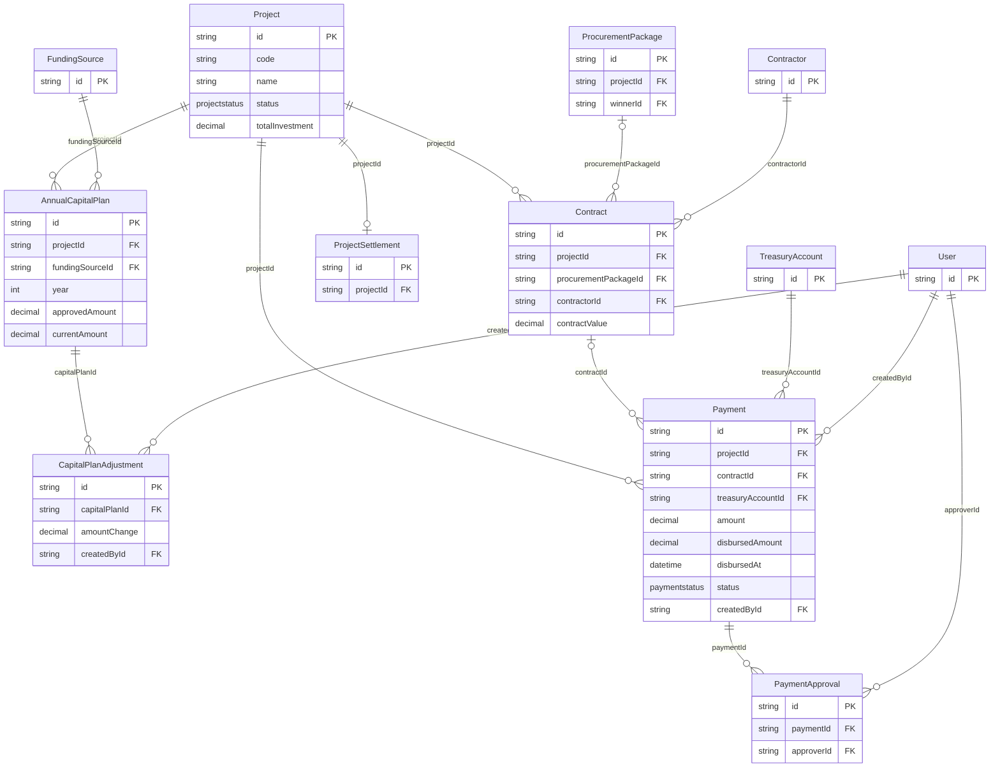
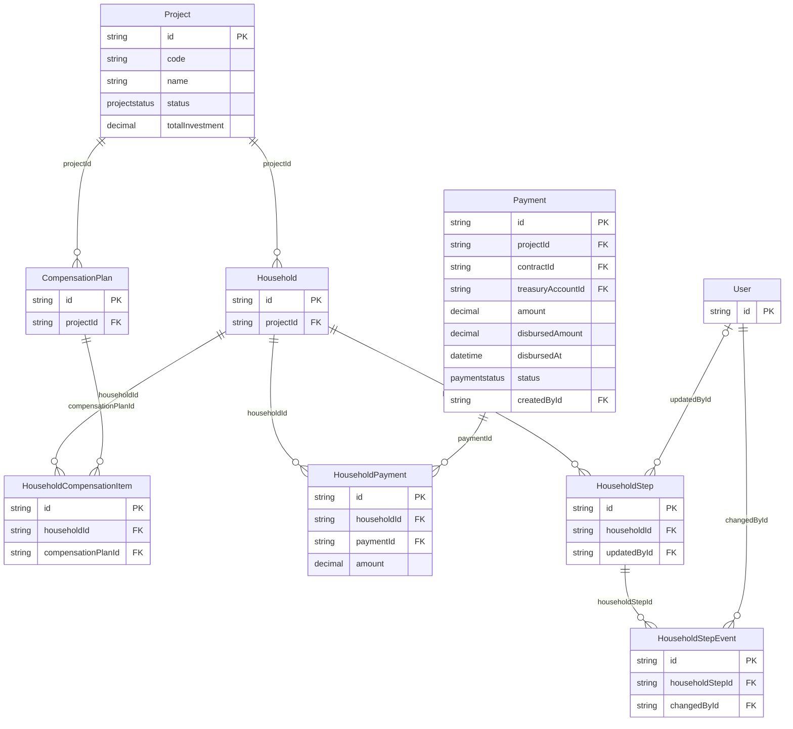
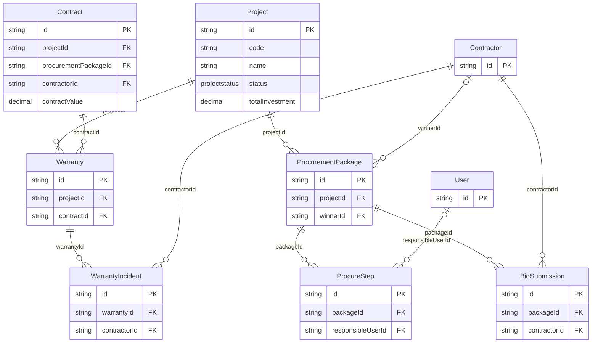
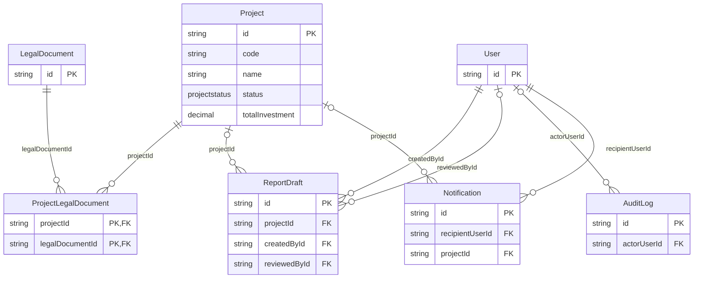

# Sơ đồ quan hệ cơ sở dữ liệu

Nguồn: [`prisma/schema.prisma`](../prisma/schema.prisma). Sơ đồ phản ánh **49 model và 80 quan hệ `@relation(fields: ...)`** trong schema hiện tại.

Mỗi sơ đồ chỉ hiển thị khóa chính (`PK`), khóa ngoại (`FK`) và một số trường nghiệp vụ quan trọng để dễ đọc. Các cột còn lại nằm trong `schema.prisma`. Tên entity là tên **Prisma model**; tên bảng PostgreSQL thực tế được chỉ định bởi `@@map`.

Ký hiệu: `||` = đúng một; `|o` ở đầu trái hoặc `o|` ở đầu phải = không hoặc một; `o{` = không hoặc nhiều. Đường nối ghi tên trường FK ở bảng con. Với FK tùy chọn, đầu bảng cha là `|o`. Bảng liên kết (ví dụ `UserRole`, `PaymentAttachment`) biểu diễn quan hệ nhiều-nhiều bằng hai khóa ngoại.

## Luồng tài chính của thẻ “Giải ngân 2026”

`Project` → `AnnualCapitalPlan` (kế hoạch theo dự án, nguồn, năm); `Project` → `Payment` (các đợt thanh toán thực tế). `AnnualCapitalPlan` **không có FK trực tiếp tới** `Payment`; KPI đối chiếu hai tập dữ liệu theo năm và phạm vi dự án.

## Người dùng, phân quyền, tiến độ và thủ tục

11 model · 15 quan hệ.

## Kế hoạch vốn, hợp đồng, giải ngân và quyết toán

12 model · 14 quan hệ.

## Giải phóng mặt bằng và bồi thường

9 model · 10 quan hệ.

## Đấu thầu và bảo hành

9 model · 10 quan hệ.

## Pháp lý, báo cáo, nhật ký và thông báo

7 model · 8 quan hệ.

## Tệp đính kèm

24 model · 23 quan hệ.

```mermaid
erDiagram
    Attachment {
        string id PK
        string uploadedById FK
    }
    CapitalAdjustmentAttachment {
        string adjustmentId PK, FK
        string attachmentId PK, FK
    }
    CapitalPlanAdjustment {
        string id PK
        string capitalPlanId FK
        decimal amountChange
        string createdById FK
    }
    CompensationPlan {
        string id PK
        string projectId FK
    }
    CompensationPlanAttachment {
        string compensationPlanId PK, FK
        string attachmentId PK, FK
    }
    DocumentTemplate {
        string id PK
    }
    DocumentTemplateAttachment {
        string documentTemplateId PK, FK
        string attachmentId PK, FK
    }
    HouseholdStep {
        string id PK
        string householdId FK
        string updatedById FK
    }
    HouseholdStepAttachment {
        string householdStepId PK, FK
        string attachmentId PK, FK
    }
    LegalDocument {
        string id PK
    }
    LegalDocumentAttachment {
        string legalDocumentId PK, FK
        string attachmentId PK, FK
    }
    Payment {
        string id PK
        string projectId FK
        string contractId FK
        string treasuryAccountId FK
        decimal amount
        decimal disbursedAmount
        datetime disbursedAt
        paymentstatus status
        string createdById FK
    }
    PaymentAttachment {
        string paymentId PK, FK
        string attachmentId PK, FK
    }
    ProcedureStepAttachment {
        string projectStepId PK, FK
        string attachmentId PK, FK
    }
    ProcureStep {
        string id PK
        string packageId FK
        string responsibleUserId FK
    }
    ProcureStepAttachment {
        string procureStepId PK, FK
        string attachmentId PK, FK
    }
    ProjectProcedureStep {
        string id PK
        string projectId FK
        string templateId FK
        string updatedById FK
    }
    ProjectSettlement {
        string id PK
        string projectId FK
    }
    ReportDraft {
        string id PK
        string projectId FK
        string createdById FK
        string reviewedById FK
    }
    ReportDraftAttachment {
        string reportDraftId PK, FK
        string attachmentId PK, FK
    }
    SettlementAttachment {
        string settlementId PK, FK
        string attachmentId PK, FK
    }
    User {
        string id PK
    }
    WarrantyIncident {
        string id PK
        string warrantyId FK
        string contractorId FK
    }
    WarrantyIncidentAttachment {
        string warrantyIncidentId PK, FK
        string attachmentId PK, FK
    }

    User ||--o{ Attachment : uploadedById
    ProjectProcedureStep ||--o{ ProcedureStepAttachment : projectStepId
    Attachment ||--o{ ProcedureStepAttachment : attachmentId
    Payment ||--o{ PaymentAttachment : paymentId
    Attachment ||--o{ PaymentAttachment : attachmentId
    CapitalPlanAdjustment ||--o{ CapitalAdjustmentAttachment : adjustmentId
    Attachment ||--o{ CapitalAdjustmentAttachment : attachmentId
    ProjectSettlement ||--o{ SettlementAttachment : settlementId
    Attachment ||--o{ SettlementAttachment : attachmentId
    CompensationPlan ||--o{ CompensationPlanAttachment : compensationPlanId
    Attachment ||--o{ CompensationPlanAttachment : attachmentId
    HouseholdStep ||--o{ HouseholdStepAttachment : householdStepId
    Attachment ||--o{ HouseholdStepAttachment : attachmentId
    ProcureStep ||--o{ ProcureStepAttachment : procureStepId
    Attachment ||--o{ ProcureStepAttachment : attachmentId
    WarrantyIncident ||--o{ WarrantyIncidentAttachment : warrantyIncidentId
    Attachment ||--o{ WarrantyIncidentAttachment : attachmentId
    LegalDocument ||--o{ LegalDocumentAttachment : legalDocumentId
    Attachment ||--o{ LegalDocumentAttachment : attachmentId
    DocumentTemplate ||--o{ DocumentTemplateAttachment : documentTemplateId
    Attachment ||--o{ DocumentTemplateAttachment : attachmentId
    ReportDraft ||--o{ ReportDraftAttachment : reportDraftId
    Attachment ||--o{ ReportDraftAttachment : attachmentId
```

## Kiểm tra độ đầy đủ

- Tổng cộng: **49 model, 80 quan hệ FK**.
- Mỗi quan hệ khai báo `@relation(fields: [...])` trong schema xuất hiện đúng một lần trong các sơ đồ trên.
- Các trường `sourceType`/`sourceId` trong `Notification` và `entityType`/`entityId` trong `AuditLog` là tham chiếu dạng chuỗi, không được schema khai báo là khóa ngoại nên không vẽ đường nối.
